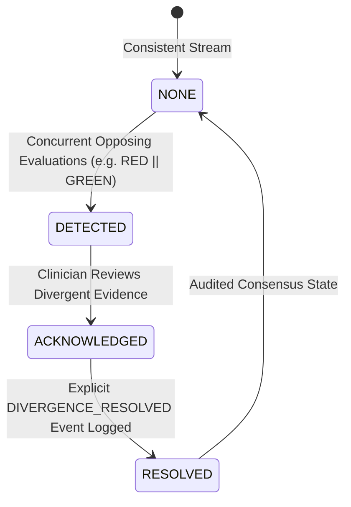

# PeerScribe Distributed Replication Semantics

## 1. Overview & Architectural Scope

PeerScribe coordinates clinical data across intermittent, offline-first tactical and humanitarian networks (Bluetooth Low Energy mesh, local Wi-Fi hotspots, ad-hoc LANs, and asynchronous Delay-Tolerant Networking).

Replication across nodes uses an **immutable, append-only, content-addressed event stream** paired with deterministic state projection and Conflict-Free Replicated Data Type (CRDT) mechanics.

---

## 2. Event Sourcing & Causal Ordering

### 2.1 Content-Addressed Identity
Every event $e$ in the PeerScribe protocol is identified by a SHA-256 hash derived over its canonical JSON serialization:
$$\text{event\_id} = \text{SHA256}(\text{CanonicalJSON}(e))$$
This guarantees:
- **Tamper Evidence**: Any modification to payloads, authors, or timestamps invalidates the ID.
- **Idempotent Ingestion**: Duplicate arrivals via multiple mesh or LAN routes are rejected with zero side-effects.

### 2.2 Logical Clocks & Causal Tracking
Replication packets carry:
1. `vector_clock: Record<string, number>`: Tracks the causal dependency frontier across participating node IDs.
2. `lamport_timestamp: number`: Monotonically increasing logical counter used for deterministic total ordering of causally concurrent operations.
3. `timestamp_ms: number`: Physical UTC epoch timestamp used for observational recency and clinical audit trails.

Two events $A$ and $B$ are concurrent ($A \parallel B$) if and only if:
$$\neg (V_A < V_B) \land \neg (V_B < V_A)$$

---

## 3. Replication Guarantees & CRDT Classification

### 3.1 What IS a CRDT in PeerScribe
- **Allergies & Tag Sets (OR-Set / Observed-Remove Set)**:
  - Additions and removals commute deterministically.
  - An element observed concurrently as added and removed is preserved as present ("Add-Wins") to err on the side of patient safety (e.g. penicillin allergy warning preserved).
- **Vitals & Observation Streams (Grow-Only Log / G-Counter sequences)**:
  - Physiological readings (heart rate, respiration rate, SpO2, blood pressure) form an immutable temporal time series.
  - Reads do not overwrite past values; projections calculate the current status as the most recent valid timestamp without discarding historical vitals.

### 3.2 What is NOT a Blind CRDT: Clinical Triage Evaluations
In distributed computer science, simple registers often resolve concurrent writes using **Last-Write-Wins (LWW)** based on wall-clock timestamps. 

**In PeerScribe, Last-Write-Wins is strictly prohibited for clinical triage decisions.**

Why? If Replica A tags a patient as `RED` (immediate life threat) and Replica B tags the same patient as `GREEN` (walking wounded) while partitioned, a blind LWW merge would silently discard one clinician's assessment based on millisecond differences in unsynchronized device clocks. In disaster medicine, this can result in preventable mortality.

---

## 4. Multi-Version Concurrency & The Divergence Lifecycle

When concurrent triage assessments occur during a network partition, the replication engine enters a formalized **three-phase clinical divergence lifecycle**:

### Phase 1: DETECTED
- The projection engine detects concurrent triage evaluations with differing categories ($c_1 \neq c_2$).
- The patient's `divergence_state` is set to `'DETECTED'`.
- The active category is flagged as `UNRESOLVED_DIVERGENCE`.
- Both assessments remain intact in `triage_history`.
- **UI Policy**: The UI is forbidden from showing either category as finalized; an amber/red pulse warning forces clinical visibility.

### Phase 2: ACKNOWLEDGED
- A responding clinician inspects both evaluations, observer credentials, and timestamps.
- An acknowledgment flag prevents alert fatigue while maintaining the divergent status.

### Phase 3: RESOLVED
- An authorized clinician performs a physical re-triage and signs an auditable `DIVERGENCE_RESOLVED` event containing:
  - `prior_divergent_event_ids`: References to the conflicting events.
  - `chosen_category`: The authoritative clinical determination.
  - `resolution_rationale`: Clinical rationale (e.g., "Patient decompensated from GREEN to RED due to tension pneumothorax").
  - `resolver_signature`: Digital signature of the resolving clinician.
- The state returns to `'RESOLVED'`. Historical events are retained permanently in the audit trail.

---

## 5. Anti-Entropy & Transport Protocols

### 5.1 LAN HTTP Synchronization (`LanSyncService`)
- Runs an embedded HTTP listener on port `4322` (Flutter) and `4323` (Electron).
- Discovery: `GET /api/v1/sync/info` returns safe node metadata; **never exposes secrets, tokens, or pairing PINs**.
- Pairing Handshake: `POST /api/v1/sync/pair` exchanges dynamic 6-digit pairing PINs and mutual 256-bit nonces. Derives 256-bit encryption keys and auth tokens via RFC 5869 HKDF-SHA256.
- In-Transit Confidentiality: All clinical event bundles are encrypted using standard AES-256-GCM (NIST SP 800-38D).
- Session Binding & Replay Protection: Requests require `X-PeerScribe-Session`, `X-PeerScribe-Token`, `X-PeerScribe-Peer-Id`, unique nonces, and bounded timestamp skew (<= 5 min). Mismatched peer identities are rejected with 403 Forbidden. Replayed nonces are rejected with 409 Conflict.
- Strict Durable Acknowledgement Invariant: **No event is ever removed from the sender's outbox solely because a receiver replied HTTP 200.** Events are acknowledged only after successful durable SQLite/filesystem persistence or verification of an existing durable copy. Unpersisted, malformed, or invalid schema events are rejected and never acknowledged.
- DTN Store-and-Forward: Ingested events are enqueued into the local outbox queue for multi-hop propagation to downstream peers. Personal profile data is isolated in separate encrypted vaults and is never forwarded unless explicitly disclosed through an emergency `VAULT_SNAPSHOT_ATTACHED` event.

### 5.2 Bluetooth Low Energy (BLE) Mesh & DTN
- Bundles larger than BLE MTU (512 bytes) are fragmented using binary wire framing with LZ4 compression and CRC-32 integrity validation.
- Store-and-Forward DTN outbox buffers bundles with hop counts up to 15.
- Anti-Entropy Bloom Filters (128 bytes) suppress redundant transmissions across the local RF vicinity.

### 5.3 Nostr WAN Bridge (Explicitly Experimental)
- Labeled experimental pending production relay transport infrastructure.
- Uses NIP-01 canonical serialization and BIP-340 Schnorr signatures over secp256k1.
- All clinical payloads are encrypted with ChaCha20-Poly1305 using tactical cluster keys.
- Local duplicate suppression cache enforces bounded memory (1000 events max).
- Unencrypted clinical information is never dispatched to public relays.
